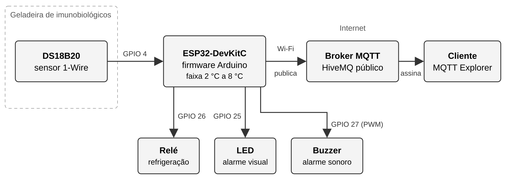
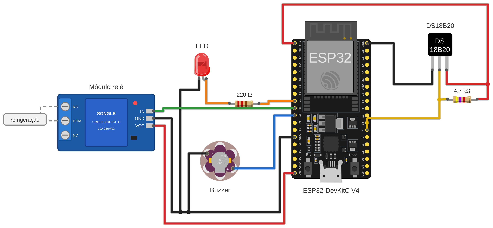
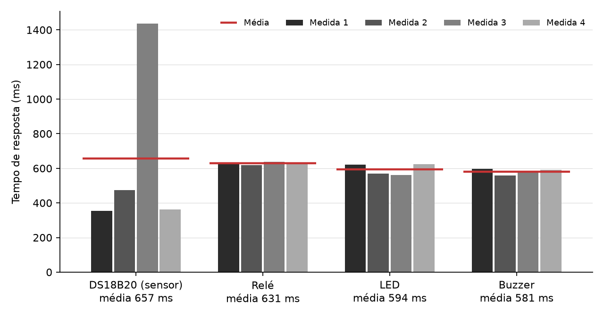
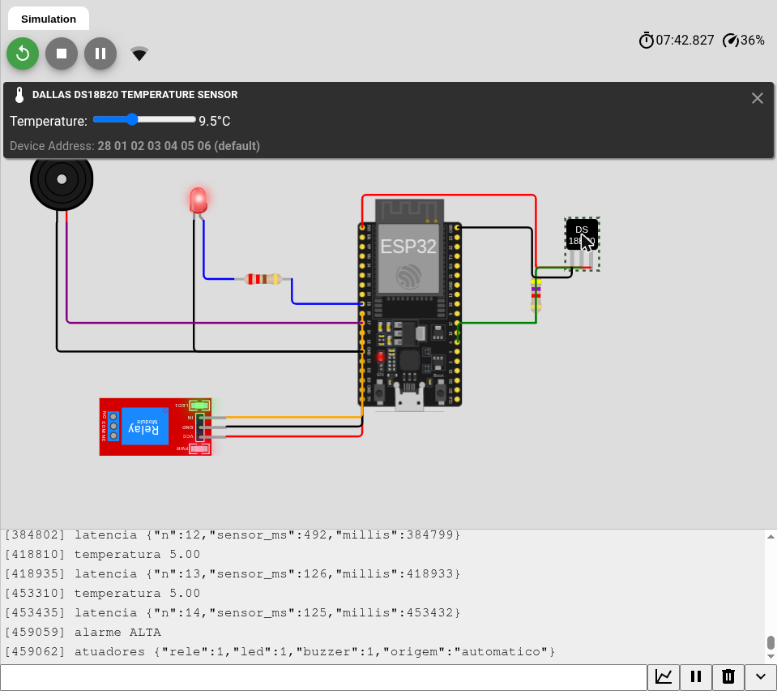
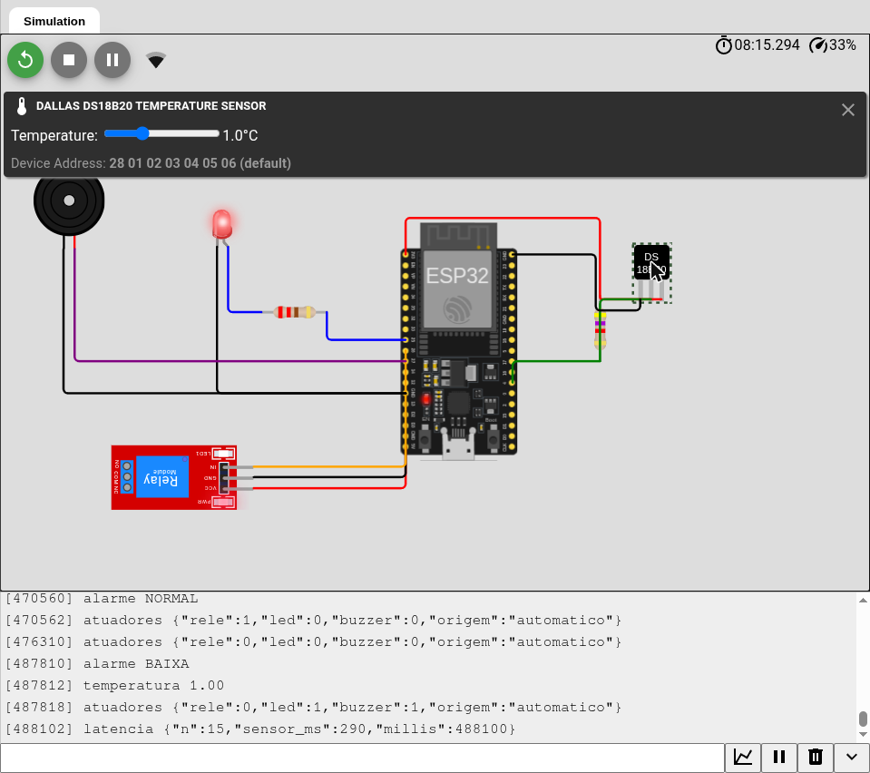
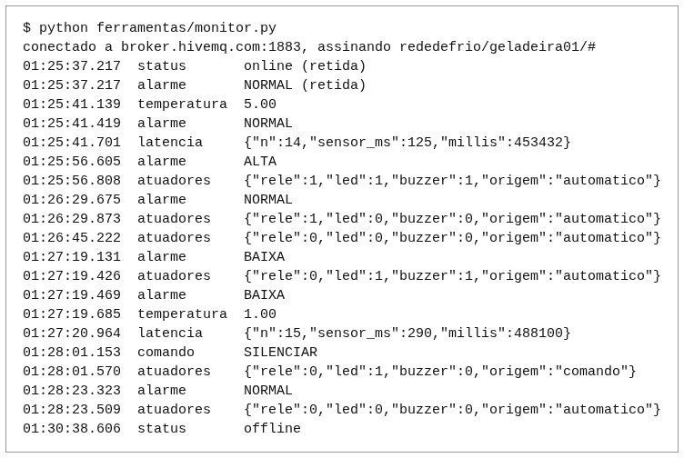

# Monitoramento de temperatura da geladeira de vacinas com ESP32 e MQTT

Protótipo de IoT que monitora a temperatura de uma geladeira de vacinas. Um sensor DS18B20 é lido por um ESP32, que publica as leituras em um broker MQTT e aciona um relé (refrigeração), um LED e um buzzer (alarme local) quando a temperatura sai da faixa de 2 °C a 8 °C. O projeto roda no simulador Wokwi e está alinhado ao ODS 3 (saúde e bem-estar).

Trabalho da disciplina Objetos Inteligentes Conectados, Universidade Presbiteriana Mackenzie, 2026. Autor: Pedro Emmanuel Esteves.



## Como funciona

1. A cada 5 s o ESP32 pede uma conversão ao DS18B20 e lê a temperatura.
2. A leitura passa pela regra da rede de frio:

| Temperatura | Relé (refrigeração) | LED e buzzer | Alarme publicado |
|---|---|---|---|
| Abaixo de 2 °C | Desligado | Ligados | `BAIXA` |
| De 2 °C a 6 °C | Desligado | Desligados | `NORMAL` |
| De 6 °C a 8 °C | Mantém o estado anterior | Desligados | `NORMAL` |
| Acima de 8 °C | Ligado | Ligados | `ALTA` |

3. O alarme só encerra com margem de 0,5 °C (abaixo de 7,5 °C ou acima de 2,5 °C), para não oscilar no limite.
4. A cada 30 s a temperatura é publicada no broker. Mudanças de alarme e de atuadores são publicadas na hora.
5. Pelo tópico de comando é possível testar cada atuador à distância e silenciar o buzzer.

O fluxo completo está em [docs/img/fluxograma.png](docs/img/fluxograma.png).

## Como reproduzir

### No Wokwi (sem hardware)

1. Abra <https://wokwi.com/projects/new/esp32>.
2. Copie o conteúdo de [`firmware/sketch.ino`](firmware/sketch.ino) para a aba `sketch.ino`.
3. Copie o conteúdo de [`firmware/diagram.json`](firmware/diagram.json) para a aba `diagram.json`.
4. Na aba Library Manager, adicione `PubSubClient`, `OneWire` e `DallasTemperature` (as mesmas de [`firmware/libraries.txt`](firmware/libraries.txt)).
5. Inicie a simulação. O monitor serial mostra a conexão ao Wi-Fi e ao broker.
6. Clique no DS18B20 e mova o controle de temperatura para simular os desvios.

### Acompanhando pelo MQTT

Qualquer cliente MQTT serve. Com o Mosquitto:

```bash
mosquitto_sub -h broker.hivemq.com -t 'rededefrio/geladeira01/#' -v
mosquitto_pub -h broker.hivemq.com -t rededefrio/geladeira01/comando -m TESTE_RELE
```

Ou com os scripts deste repositório:

```bash
pip install paho-mqtt matplotlib
python ferramentas/monitor.py                      # mostra todas as mensagens
python ferramentas/medir.py -o medicoes/medicoes.csv   # mede os tempos de resposta
python ferramentas/grafico.py medicoes/medicoes.csv docs/img/tempos.png
```

### Em uma placa física

O mesmo `sketch.ino` grava em uma ESP32-DevKitC pela IDE do Arduino, com o pacote de placas ESP32 da Espressif e as três bibliotecas acima. Basta trocar `WIFI_SSID` e `WIFI_SENHA` no início do arquivo.

## Hardware

| Componente | Função | Ligação no ESP32 |
|---|---|---|
| ESP32-DevKitC V4 (ESP32-WROOM-32E) | Microcontrolador com Wi-Fi | |
| DS18B20 | Sensor de temperatura, 1-Wire, ±0,5 °C | VDD no 3V3, DQ na GPIO 4 com pull-up de 4,7 kΩ, GND no GND |
| Módulo relé 5 V (SRD-05VDC-SL-C) | Atuador: liga a refrigeração | VCC no 5V, IN na GPIO 26, GND no GND |
| LED vermelho 5 mm + resistor de 220 Ω | Atuador: alarme visual | Anodo na GPIO 25 pelo resistor, catodo no GND |
| Buzzer piezoelétrico | Atuador: alarme sonoro, 2 kHz intermitente | Positivo na GPIO 27, negativo no GND |



O projeto não usa peças impressas em 3D nem caixa. Em uma instalação real o DS18B20 seria a versão em sonda de aço inoxidável, dentro da geladeira, com a placa do lado de fora.

## Comunicação

- **Rede:** Wi-Fi 802.11 b/g/n do próprio ESP32, TCP/IP. No Wokwi, a rede é a `Wokwi-GUEST`.
- **Protocolo:** MQTT 3.1.1, pela biblioteca PubSubClient.
- **Broker:** `broker.hivemq.com`, porta 1883 (público, sem autenticação, só para testes).
- **Prefixo dos tópicos:** `rededefrio/geladeira01`.

| Tópico | Sentido | Conteúdo | Retida |
|---|---|---|---|
| `temperatura` | ESP32 publica | Leitura em °C, a cada 30 s. Ex.: `5.25` | Não |
| `alarme` | ESP32 publica | `NORMAL`, `ALTA` ou `BAIXA`, a cada mudança e junto com a temperatura | Sim |
| `status` | ESP32 publica | `online` ao conectar; `offline` pelo Last Will (QoS 1) | Sim |
| `atuadores` | ESP32 publica | Estado a cada mudança. Ex.: `{"rele":1,"led":1,"buzzer":1,"origem":"automatico"}` | Não |
| `latencia` | ESP32 publica | Tempo entre a leitura do sensor e o retorno da publicação pelo broker. Ex.: `{"n":3,"sensor_ms":125,"millis":349966}` | Não |
| `comando` | ESP32 assina (QoS 1) | `TESTE_RELE`, `TESTE_LED`, `TESTE_BUZZER` (aciona por 3 s) ou `SILENCIAR` (cala o buzzer até o alarme encerrar) | Não |

A PubSubClient publica apenas em QoS 0. Para compensar, o estado do alarme é retido no broker e repetido a cada 30 s junto com a temperatura. O keepalive é de 90 s porque o simulador pode rodar mais devagar que o tempo real, e com valores menores o broker encerrava a conexão.

## Software

O firmware está em um único arquivo, [`firmware/sketch.ino`](firmware/sketch.ino), comentado por blocos:

| Função | O que faz |
|---|---|
| `setup()` | Configura as GPIOs em nível baixo, o DS18B20 em 12 bits, o Wi-Fi e o cliente MQTT |
| `loop()` | Mantém a conexão, lê o sensor a cada 5 s sem bloquear, publica a cada 30 s e atualiza os atuadores |
| `conectarMqtt()` | Conecta ao broker com Last Will, assina os tópicos e tenta de novo a cada 5 s se cair |
| `avaliar()` | Aplica a regra de temperatura: alarme com histerese e liga/desliga da refrigeração |
| `aplicarAtuadores()` | Leva às GPIOs a combinação de decisão automática, teste remoto e silenciamento |
| `aoReceber()` | Trata os comandos recebidos e mede a latência pelo eco da própria publicação |
| `publicar...()` | Montam e enviam as mensagens de temperatura, alarme e atuadores |

Scripts de apoio, em Python:

- [`ferramentas/monitor.py`](ferramentas/monitor.py): mostra todas as mensagens do protótipo com horário.
- [`ferramentas/medir.py`](ferramentas/medir.py): mede os tempos de resposta dos atuadores e do sensor e grava um CSV.
- [`ferramentas/grafico.py`](ferramentas/grafico.py): gera o gráfico a partir do CSV.

## Resultados

Tempos medidos com o protótipo no Wokwi e o broker público da HiveMQ, quatro medidas por item ([`medicoes/medicoes.csv`](medicoes/medicoes.csv)):

| Item | Medidas (ms) | Média (ms) |
|---|---|---|
| DS18B20 (leitura até o retorno do broker) | 354,7 / 473,9 / 1435,6 / 362,5 | 656,7 |
| Relé (comando até a confirmação) | 635,1 / 619,0 / 638,2 / 629,9 | 630,5 |
| LED (comando até a confirmação) | 620,2 / 569,2 / 561,6 / 625,3 | 594,1 |
| Buzzer (comando até a confirmação) | 597,8 / 557,7 / 577,0 / 591,5 | 581,0 |



| Operação normal (5 °C) | Temperatura alta (9,5 °C) | Temperatura baixa (1 °C) |
|---|---|---|
|  |  |  |

O registro das mensagens trocadas durante os ensaios está em [`medicoes/monitor.log`](medicoes/monitor.log):



## Estrutura

```
firmware/      sketch.ino, diagram.json e libraries.txt (projeto Wokwi)
ferramentas/   scripts de monitoramento, medição e gráfico
medicoes/      dados brutos dos ensaios
docs/img/      diagramas, fluxograma e capturas
```

## Licença

MIT. Ver [LICENSE](LICENSE).
